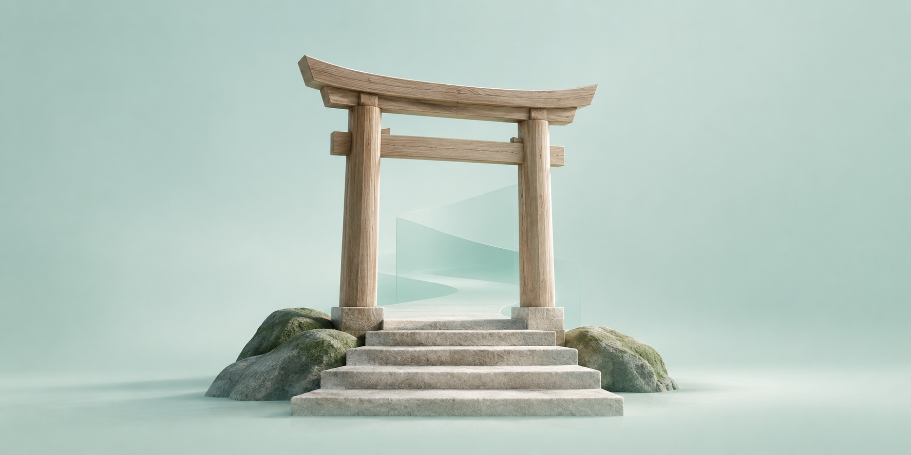

# Design system: the Edudojo family

This site and edudojo.ai share one design language. Edudojo is the company; this is the person. They share type, spacing, shape and motion. Colour, content, the portrait, the G mark and the dot symbols make each one distinct.

## Colour identity (owner decision, 14 October 2026)

Edudojo is green on green-black paper. This site is McLaren papaya (`#FF8000`) on warm graphite: the same creator, a different purpose. The token names stay the family's role names (`--leaf`, `--forest`, `--sage`), so code reads the same in both repositories; only the values differ. Here `--leaf` is papaya, `--forest` is anthracite and `--sage` is a warm wash. Edudojo's own marks (its gate image and gate mark) keep Edudojo's green, because they are Edudojo's brand.

## Idea

Edudojo's idea is "the stroke shows the hand": show how the work was made, not only the result. Here, every tool is shown as the question it answers and the process it supports. The site reads as an index of ideas, not a gallery of pictures. It is calm and literary, and precise like an instrument.

## Tokens

Tokens are CSS variables in the token block of `app/field.css`, with an `html.dark` override. The private pages (`/login`, `/editorial`, `/ledger`) use the same tokens through `app/atelier.css`. The site's older `--color-*` names point at these tokens, so every page follows them. Change a value there, never in a component.

| Token | Use |
|---|---|
| `--paper` / `--paper-raised` | Page / the one raised object in a view (the hero's "now" card) |
| `--sage` | The wash at the top of the hero; the soft field behind a lead glyph |
| `--ink` / `--ink-2` | Text / muted text and a heading's second tone |
| `--rule` | 1px hairlines between rows and sections |
| `--forest` / `--on-forest` | The anthracite filled button: one in the content of a view, plus the header's Contact (as on Edudojo). In dark mode it becomes light ink with dark text |
| `--leaf` | Papaya. A signal: dots, the last step of a process, focus. Never small text |
| `--leaf-ink` | Orange text, link hover |
| `--clay` | Crimson. Corrections and warnings only |

Dark mode is soft on purpose (owner, 14 October 2026): near-white at 16:1 on near-black glowed and tired the eye. Paper is lifted to `#151413`, `--ink` is `#E0DDD8` (about 13.6:1), and long text (essay and Notes paragraphs, lists) uses `--color-text-reading` `#C2BDB6` (about 9.9:1). Headings and bold text keep `--ink`. Keep dark text between about 10:1 and 14:1; do not go back to pure white.

The inverted band (Notes on the homepage) has its own background: `#1B1A18` in light mode, `#24221F` in dark mode. Its text (`--band-ink`) is `#F3F1EA` in light mode and `#E0DDD8` in dark mode.

## Type

- Instrument Sans for headings, text and UI. Headings are weight 500 with -0.035em to -0.04em tracking. Body text is 400; 500 to 600 only for short labels.
- An `<em>` inside an h1 or h2 is the sentence's second tone: upright, in `--ink-2`. It is never an italic accent. Example: "Selected work. *Software that gives your ideas somewhere to go.*"
- Literata is for a person's writing: article and Notes prose, essay titles, quotes.
- IBM Plex Mono is for real data only: dates, months, years.
- Do not reintroduce Instrument Serif or Manrope.

## Shape

- Radii: 6px buttons, 12px small cards and the portrait, 20px stages (the "now" card, the inverted band).
- Separate with 1px `--rule` hairlines and space, not with boxes. Shadows are rare and soft.
- One bright object per view.

## Controls and navigation

- Header (public pages): Edudojo's full-width paper bar with one hairline. Its content lines up with the page column (1320px, 44/30/22px gutters, safe-area aware), so the logo sits above the headline.
- Links: muted ink (`--ink-2`), full ink on hover, and one 4px leaf dot under the active link. No pills. The private atelier nav keeps its own style.
- Filters (Playground): the same grammar as the header links, a leaf dot under the one in use. A filter appears only for a kind that has entries.
- Controls (theme toggle, menu button): 6px squares with a hairline. Filled buttons (`.btn-accent`) are always forest.
- Focus rings: `--leaf-ink` on paper (3:1 or better); `--leaf` only on the dark bands.
- The mark (14 October 2026): ink dots gather, growing, into the G's stroke; the stroke turns into the bar, and the bar ends in a papaya dot (the last step of a process path). It is the site's dot motion held still. The full cut (8 dots) is in `public/brand/` (masked for the header, tiled for downloads); the favicon `app/icon.svg` is the small cut (4 larger dots, so it holds at 16px) with no tile, its ink following `prefers-color-scheme`. The iOS icon keeps the dark tile. Regenerate every file with `node scripts/build-brand-mark.mjs`; never hand-edit one cut.

## The index grammar (`app/index-list.css`)

Lists of work and writing read like a table of contents:
- `.work-meta`: name, kind and stage, separated by fine dots.
- A proposition as the title. Use the project's `subtitle` ("How close is close enough?"), not only its name.
- `ProcessPath` (`components/process-path.tsx`): the project's `steps`, joined by a dotted line. The last step has a filled leaf dot.
- `.ledger-row`: a mono date, a title, a note, an arrow.
- A `DotGlyph` names an entry instead of a picture.

## Images

- Indexes (the homepage, the Playground) use dot glyphs. A project page (`/playground/[slug]`) shows the same glyph large on a sage plate, captioned with the cover's `label` and `detail`, until a real demo recording replaces it. The owner found the illustrated SVG covers generic (11 October 2026).
- Edudojo is the one project with a photograph (its owner-approved gate image). On purpose: it is the startup, not a side project, so it should stand apart.
- The portrait is the one photograph in the homepage's first view.
- An essay's own cover image is part of the writing: it shows as a small thumbnail in essay lists (`.ledger-thumb`), never as a large card.
- No decorative stock imagery. A screenshot must be a real product screen, labelled with what it is.

## Dots (the shared motion)

Everything that moves is made of dots, as on Edudojo.

| Piece | Where | Behaviour |
|---|---|---|
| `InkWord` (`components/ink-word.tsx`) | The hero word "think" | Hollow letters fill with falling ink dots once, in about 2.6s. The word stays real text. |
| `MarginDots` (`components/margin-dots.tsx`) | Side margins of wide screens, out to the screen edge | Particles drift and gather into a stippled symbol for the section being read. Nothing is drawn when the margins are too narrow. |
| `DotWordmark` (`components/dot-wordmark.tsx`) | The footer name | Dots gather into "Gargeya" when the footer enters view, then breathe in a slow, slight wave and part around the cursor. The owner asked for this loop; it is the one exception to the rule below. |
| `DotGlyph` (`components/dot-glyph.tsx`) | Index entries, project-page plates | A static stippled figure per project, rendered on the server. It re-gathers once on hover or focus. |
| `ChapterMorph` (`app/about/chapter-morph.tsx`) | The About journey's chapter heading | On a chapter change the old heading dissolves into ink dots that re-gather as the new one (about 0.7s). The heading stays real text for readers. |

The About journey pins below the header and is centred in the space left; scrolling walks its six chapters, and a leaf line fills the route. Narrow or short windows, and pages without JavaScript, get the compact click-through.

Shapes live in one library, `lib/stipple.ts`. Rules:
- One focal motion per view. Nothing loops for attention, except the footer wordmark's slow wave (owner's request), which stops off screen.
- Every motion has a reduced-motion state that shows the final figure, still.
- Pause when the page is hidden or the element is off screen. Do no work when there is nothing to show.
- Dots never sit under text.

## Do and don't

- Do lead with an idea or a question; follow with the name.
- Do keep each section to a heading in two tones, one list, one onward link.
- Don't add image cards to an index.
- Don't use papaya (`--leaf`) for small text, or more than one filled button in a view's content.
- Don't animate layout properties; use transform and opacity only.

---

# Project cover art direction

Use this blueprint when creating or revising portfolio project covers. It applies to each project's own page (`/playground/[slug]`); indexes use dot glyphs instead (see Images above).

For site philosophy, see [personal-world-design.md](docs/personal-world-design.md). For cover metadata, SVG components, image exceptions, and publishing checks, use [project-cover-system.md](docs/project-cover-system.md). This file owns the creative brief; that guide owns implementation.

## The approved reference



The owner approved this minimal gate illustration on 29 September 2026 after seeing it in the actual website. It was generated with ChatGPT Images using the original forest image and a screenshot of the project collection as references. The template below distills that successful prompt; it is not a verbatim transcript or a guarantee of identical output.

What carries forward: one recognizable subject, generous space, restrained depth, soft light, muted color, and a clear silhouette at card size. What stays specific to Edudojo: the gate, steps, wood, stone, and journey metaphor. The illustration is not the exact company logo; the separate watermark uses the owner's mark.

## Decisions before drawing

1. Write the project's purpose and one visible action in plain language. Choose a subject that expresses that action. End with a sentence such as “A waveform becomes editable text.”
2. Choose the medium. Custom SVG remains the default. Apply this brief through code and shared primitives; use the generation template for an authorized raster illustration or a concept study. A concept study does not automatically replace a published cover.
3. Select references by role: subject/brand reference for identity, the approved cover for restraint, and a current page screenshot for context. Preserve exact logos through their source assets rather than trusting a generated approximation.
4. Fill the template with project-specific decisions. Remove irrelevant materials and props. Keep the shared composition and lighting direction.
5. Review the output in its actual placements using the acceptance checks below. Revise the specific failure; do not improve the score just because another image was generated.

## Shared style, variable subject

| Keep consistent | Let the project determine |
| --- | --- |
| One dominant subject or small related group | The object, action, and visual metaphor |
| Muted sea, mist, or lilac background from the cover palette | Which palette best separates the subject |
| Subtle dimensional depth and a soft grounding shadow | Flat, layered, or architectural construction |
| Diffused light, open shadows, restrained highlights | Material that supports meaning: glass, paper, wood, stone, or simple drawn forms |
| Generous margins and a legible silhouette | Orientation and arrangement within the shared frame |
| Quiet illustration beside readable HTML titles | Short captions explaining the project's specific idea |

Use the live color tokens in `app/project-media.css`. Raster references may approximate those colors; SVG scenes consume the tokens. Natural wood and stone are optional, not a new collection-wide requirement. Glass planes should carry meaning such as a layer, boundary, or surface; omit them when they only add decoration.

## Reusable generation prompt

Replace every bracketed field. Attach the references described in the prompt. Generate the artwork alone; keep website text and controls in the interface.

```text
Create one standalone project-cover illustration for [PROJECT], landscape 2:1.

Purpose: [WHAT THE PROJECT HELPS SOMEONE DO].
Visual idea: [ONE RECOGNIZABLE SUBJECT AND ONE MEANINGFUL ACTION].

References:
- Image 1 is the subject or brand reference: preserve [IDENTITY DETAILS].
- Image 2 is the approved Edudojo cover: match its restraint, space, soft
  lighting, and dimensional clarity; use this project's own subject.
- Image 3 is the current website: the artwork must belong beside its quiet
  sea-glass SVG covers in both warm-paper light mode and green-black dark mode.

Art direction: a carefully crafted editorial illustration with the clarity
of a small physical model. Use [MATERIALS THAT SUPPORT THE IDEA], precise
forms, subtle depth, and a soft grounding shadow. Keep surface detail quiet
enough to read at thumbnail size.

Composition: [SUBJECT ARRANGEMENT]. One dominant subject or a small related
group, generous negative space, and a complete readable silhouette. Aim for
the main subject inside the central 55–65% of the canvas width and 65–75%
of its height. Leave essential features clear of every edge. Account for
the actual wide and mobile crops shown in the website reference.

Color and light: [SEA / MIST / LILAC BACKDROP AND RELEVANT TOKEN COLOR],
desaturated teal or slate details, with [ONE RESTRAINED ACCENT IF NEEDED].
Diffused daylight, open shadows, gentle highlights, and clean separation
between subject and backdrop. The mood is thoughtful, welcoming, and calm.

Deliver a single full-bleed artwork. No text, interface, border, watermark,
invented logo, neon glow, floating particles, dense scenery, or unrelated
props. Keep product demonstrations and factual claims out of the artwork.
```

The margin percentages are starting constraints, not proof of crop safety. Check the rendered result. The approved Edudojo image needed a full 2:1 detail frame because the previous shallow banner clipped the gate.

## Example briefs

| Project | Meaning to illustrate | Useful forms and materials |
| --- | --- | --- |
| Edudojo | Progress through learning | One pale wooden gate, ascending stone steps, quiet sea-green surroundings |
| Odicto | Speech becoming text | A waveform resolving into a few aligned text strokes on one surface |
| TwinAatma | Context carried forward under the user's control | A small group of memory layers with a deliberate review boundary |
| Odicto Mobile | Speech becoming text inside a phone keyboard | A phone outline, a short waveform, and keyboard rows with one microphone key |
| DataCleanOpenEnv | Inspecting and improving data | Irregular rows becoming ordered, with the change easy to trace |
| This website | Turning work into something others can explore | A publishing surface connecting code, writing, and a destination |

These are starting briefs, not mandatory compositions. Differentiate the project through its meaning, not a palette swap. Do not repeat gates, stone pedestals, or generic glass panels across every cover.

## Acceptance in context

Before recommending or publishing artwork:

- Place it beside the existing covers on the actual page. Inspect light and dark modes at desktop and 320px. Check the project page crop; confirm the complete subject and readable silhouette.
- Compare cleanliness, palette fit, subject clarity, distinctiveness, and brand fidelity. Name the weakest criterion and the visible evidence. A beautiful standalone image can still fail as a cover.
- Confirm the subject relates to what the project actually does. Label illustrative explanations separately from product screenshots or demonstrations.
- Reject accidental clipping, unnecessary props, invented brand geometry, muddy material boundaries, or a dramatic contrast level that overwhelms adjacent cards.
- Treat numerical scores as subjective review notes, not objective measurements or a target to inflate. Show the in-page comparison and disclose checks that were not performed.
- When the visual changes are complete, follow the implementation and verification steps in [project-cover-system.md](docs/project-cover-system.md).

## Current collection decision

11 October 2026: SVG covers no longer render (see Images above). Project pages show glyph plates until the owner's demo recordings replace them; Edudojo keeps its gate image. Every project still carries `cover` metadata, which the cover check enforces, and the guidance in this section applies if illustrated covers return.
